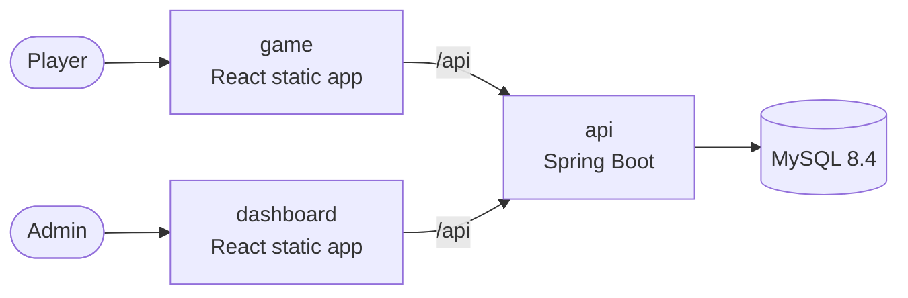

# Hangman online

Demo project of the **CI/CD** class (Campus Numérique): an online Hangman game, with a dashboard
showing statistics and managing the dictionary.

Your job is **not** to code the app, it's ready. Your job is to **containerize it, build it, test it
and deploy it** with GitLab CI/CD. Follow the class instructions.

## Architecture



| Folder | What | Stack | Details |
|---|---|---|---|
| [`api/`](api/) | REST API | Java 25, Spring Boot 4, Maven, Flyway | [api/README.md](api/README.md) |
| [`game/`](game/) | The game | React, Vite, TanStack Router & Query | static build in `dist/` |
| [`dashboard/`](dashboard/) | Stats & dictionary | React, Vite, TanStack Router, Query & Table | static build in `dist/` |

Both front-end apps:
- call the API with **relative URLs** (`/api/...`): in production, something must route `/api` to the API;
- read their runtime configuration from **`/config.json`** (`{"sentryDsn": "...", "environment": "...", "version": "..."}`).
  The repository ships an empty one (`public/config.json` = `{}`), which disables Sentry.

## Develop locally (devcontainer)

Requirements: Docker and VS Code with the
[Dev Containers](https://code.visualstudio.com/docs/devcontainers/containers) extension
(or any tool supporting the [devcontainer spec](https://containers.dev/)).

1. Open the repository in VS Code → **Reopen in Container**.
   The devcontainer provides Java 25, Node 24, the Docker CLI and a MySQL 8.4 database.
2. Start everything with `make dev` (run `make` to list all the shortcuts), or each part in its own terminal:

```bash
# API → http://localhost:8080
cd api && ./mvnw spring-boot:run

# Game → http://localhost:5173
cd game && npm run dev

# Dashboard → http://localhost:5174
cd dashboard && npm run dev
```

The Vite dev servers proxy `/api` to `http://localhost:8080` (override with `API_PROXY_TARGET`).

## Useful commands

Without the devcontainer, `make db` starts a MySQL 8.4 container on `localhost:3306`.

| | api | game / dashboard |
|---|---|---|
| Install dependencies | `./mvnw dependency:go-offline` | `npm ci` |
| Run the tests | `./mvnw verify` | `npm test` |
| Lint | | `npm run lint` |
| Build | `./mvnw package` → `target/*.jar` | `npm run build` → `dist/` |

## Configuration (API)

| Variable | Default | Description |
|---|---|---|
| `SPRING_DATASOURCE_URL` | `jdbc:mysql://localhost:3306/hangman` | JDBC URL of the database |
| `SPRING_DATASOURCE_USERNAME` / `SPRING_DATASOURCE_PASSWORD` | `hangman` / `hangman` | Database credentials |
| `APP_VERSION` | `dev` | Version shown in the apps footer and sent to Sentry |
| `APP_ENVIRONMENT` | `development` | Environment name shown in the footer and sent to Sentry |
| `SENTRY_DSN` | *(empty)* | Enables Sentry error tracking when set |
| `ADMIN_TOKEN` | *(empty)* | When set, adding/deleting words requires the `X-Admin-Token` header |

Health check: `GET /actuator/health`.
